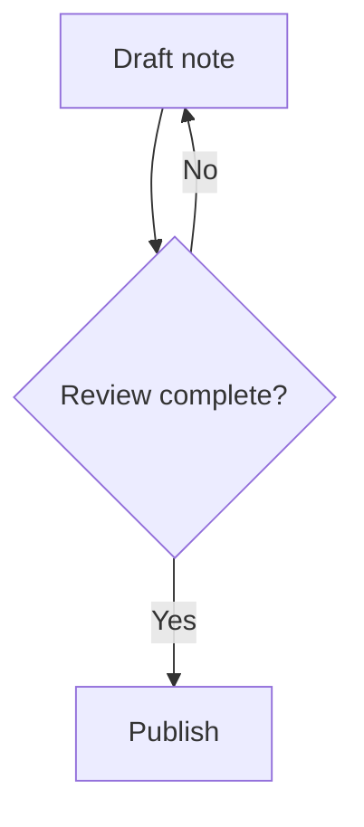
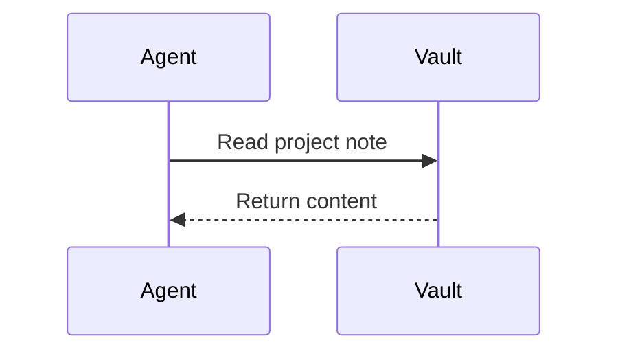
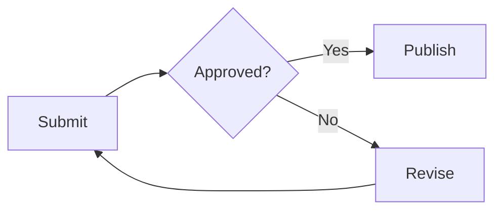

# Obsidian writing guide

Use this guide for examples of Markdown that renders in Obsidian. Follow the user's explicit instructions first. When editing, keep the existing note's structure and style. For a new note or a pattern the note does not show, check the vault's templates and similar notes. Use these defaults when there is no local pattern.

## formatting

Use a space after the heading marks. Leave a blank line between paragraphs. Use consistent list markers and indentation. Use `==text==` to highlight text and a backslash to show Markdown punctuation as text.

````markdown
# Release notes

**Ready:** The build passed. *Pending:* The review.
Keep the ==migration note== near the top.

- First change
  - Related detail

> Quote the decision here.

Use \* to show an asterisk.
````

[Basic formatting syntax](https://obsidian.md/help/syntax)

## links

Use `[[Note]]` for vault links when that matches local style. Qualify duplicate names with a vault-relative path. The link target is the file name or path, even when the displayed text uses an alias. Use `#Heading` for a heading or `#^id` for a block. Put a block ID after paragraph text or on its own line after a list or quote. Use standard Markdown links for external URLs.

````markdown
[[Projects/Apollo|Project Apollo]]
[[Projects/Apollo#Milestones]]
[[Projects/Apollo#^launch-date]]
[[#Next steps]]
[Obsidian Help](https://obsidian.md/help)

The launch is on 2026-12-10. ^launch-date
````

[Internal links](https://obsidian.md/help/links)

## embeds

Add `!` before a wikilink to display its target inline. Use a heading or block when the note only needs part of the source. Use `|width` for image width and `#page=N` for a PDF page.

````markdown
![[Projects/Apollo#Milestones]]
![[Projects/Apollo#^launch-date]]
![[apollo-timeline.png|480]]
![[field-recording.mp3]]
![[release-brief.pdf#page=3]]
````

[Embed files](https://obsidian.md/help/embeds)

## callouts

Start a quoted block with `[!type]`. Common types include `note`, `tip`, `info`, `warning`, and `example`. Prefix each body line with `>`. Use `-` after the type to start closed, or `+` to start open. Use an extra quote marker for a nested callout.

````markdown
> [!warning] Review the destination
> The backup must finish before the migration.

> [!example]- Verification details
> Compare the record counts.
>
> > [!tip] Check the date
> > Use today's export.
````

[Callouts](https://obsidian.md/help/callouts)

## mermaid

Use a fenced `mermaid` block. Give nodes stable IDs and use short labels. For a long workflow, show the main decisions before adding details. For links, use the syntax in the pinned skill excerpt below.

````markdown



````

[Advanced formatting syntax](https://obsidian.md/help/advanced-syntax#Diagram)

## tables

Put a blank line above a table and add a separator row under the header. Escape cell pipes as `\|`, including the pipe that sets a wikilink's display text. Use a list if cells need long paragraphs.

````markdown
Current status:

| Project | Status |
| --- | --- |
| [[Projects/Apollo\|Apollo]] | In review |
| [[Projects/Gemini]] | Ready |
````

[Advanced formatting syntax](https://obsidian.md/help/advanced-syntax#Tables)

## properties

Place YAML properties at the start of the file between lines that contain only `---`. Quote wikilinks in YAML. Use a consistent property type across the vault. Use `tags` and `aliases` as lists. When changing one key through MCP, use `note_properties` to preserve the other fields.

````markdown
---
status: in-review
date: 2026-11-17
related: "[[Projects/Apollo]]"
aliases:
  - Apollo check-in
tags:
  - project/apollo
completed: false
---
````

[Properties](https://obsidian.md/help/properties)

## tags

Use a `#` before an inline tag. In the YAML `tags` list, omit the `#`. Use `/` for a hierarchy. Keep tags free of spaces and include at least one nonnumeric character.

````markdown
---
tags:
  - project/apollo
  - status/active
---

Track the review under #project/apollo.
````

[Tags](https://obsidian.md/help/tags)

## math

Put inline LaTeX between single dollar signs. Use double dollar signs on separate lines for a display formula.

````markdown
The rate is $r = d / t$.

$$
r = \frac{120}{3} = 40
$$
````

[Advanced formatting syntax](https://obsidian.md/help/advanced-syntax#Math)

## code

Use backticks for inline code. Use a fenced block with a language name for syntax highlighting. Use a longer outer fence when the example itself contains a fence.

````markdown
Set `status` to `active`.

```json
{"status": "active"}
```
````

[Basic formatting syntax](https://obsidian.md/help/syntax#Code)

## footnotes

Use `[^key]` in the text and define `[^key]:` on a separate line. Use a different key for each definition.

````markdown
Use the corrected counts.[^counts]

[^counts]: Counts exclude test records.
````

[Basic formatting syntax](https://obsidian.md/help/syntax#Footnotes)

## comments

Use `%%` at the start and end of a comment. Obsidian hides comments in Reading view. They remain in the file.

````markdown
This note is ready for review. %% Remove the draft example later. %%

%%
Keep this wording for the next review.
%%
````

[Basic formatting syntax](https://obsidian.md/help/syntax#Comments)

## checkboxes

Use `- [ ]` for an open task and `- [x]` for a completed task. Indent nested tasks under their parent. When editing a note that uses a plugin's custom states or metadata, follow the vault's existing format.

````markdown
- [ ] Prepare the release
  - [x] Run the tests
  - [ ] Check the release notes
````

[Basic formatting syntax](https://obsidian.md/help/syntax#Task+lists)

## meeting

Record decisions, open questions, and actions. Link the project and add an owner and due date when known.

````markdown
# Apollo check-in

Project: [[Projects/Apollo]]

## Decisions
- Run the pilot with one group.

## Actions
- [ ] Maya: send the pilot checklist by 2026-11-20.

## Open questions
- Which group should join first?
````

Project recipe. [Internal links](https://obsidian.md/help/links), [Task lists](https://obsidian.md/help/syntax#Task+lists).

## decision

State the decision, why it was taken, and its consequences. Link the evidence that informed it.

````markdown
# Keep the pilot on the existing platform

## Context
The pilot needs one group and a quick rollback. See [[Apollo pilot tests]].

## Decision
Use the existing platform for the pilot.

## Consequences
- The team can follow the current runbook.
- Schedule a platform review after the pilot.
````

Project recipe. [Internal links](https://obsidian.md/help/links).

## runbook

Start with when to use the runbook. List prerequisites, ordered steps, verification, and rollback. Put risks next to the step they affect.

````markdown
# Restore the staging export

## Before you start
- Confirm that the export belongs to staging.

> [!warning] Preserve the current export
> Copy it to the backup folder before restoring.

## Steps
1. Open the backup index.
2. Restore the selected file.

## Verify
Compare the record count with the backup index.

## Rollback
Restore the copy made before step 1.
````

Project recipe. [Lists](https://obsidian.md/help/syntax#Lists), [Callouts](https://obsidian.md/help/callouts).

## daily

Use the vault's daily note template if it has one. Keep priorities, notes, and follow-up actions easy to scan.

````markdown
# 2026-11-17

## Priorities
- [ ] Confirm the pilot date.

## Notes
- The team reviewed [[Projects/Apollo#Milestones]].

## Follow-up
- [ ] Share the meeting summary.
````

Project recipe. [Daily notes](https://obsidian.md/help/plugins/daily-notes), [Task lists](https://obsidian.md/help/syntax#Task+lists).

## research

Keep the finding, evidence, and limitations together. Link primary sources and put untested ideas under open questions.

````markdown
# Pilot export timing

## Finding
The first run took longer than the second.

## Evidence
- Timing and settings: [[Apollo pilot tests#Export timing]].

## Limitations
Both runs used the same small data set.

## Open questions
- Does the result hold for a larger export?
````

Project recipe. [Internal links](https://obsidian.md/help/links).

## project

State the outcome, current status, next actions, and related documents. Use the vault's project properties and templates when available.

````markdown
---
status: active
tags:
  - project/apollo
---

# Apollo

## Outcome
Run a pilot for one group.

## Next actions
- [ ] Confirm the test group.
- [ ] Book the review.

## References
- [[Apollo pilot tests]]
- [[Apollo check-in]]
````

Project recipe. [Properties](https://obsidian.md/help/properties), [Task lists](https://obsidian.md/help/syntax#Task+lists).

## process

Name the trigger, owner, main steps, and expected result. Show the decision path in a small Mermaid flowchart when it makes the steps easier to follow.

````markdown
# Review a draft

Trigger: An author submits a draft.
Owner: The assigned reviewer.



Result: A published note or a draft with review comments.
````

Project recipe. [Mermaid in Obsidian](https://obsidian.md/help/advanced-syntax#Diagram).

## task_overview

Summarize priorities and blockers. Link back to the source task. Update the checkbox in its source note so the overview does not become a second task list.

````markdown
# Task overview

## Next
- Send the checklist. Source: [[Apollo check-in#Actions]].

## Blocked
- Book the review once [[Projects/Apollo#Next actions]] has a date.

## Done
- Reviewed the test data. Source: [[Apollo pilot tests]].
````

Project recipe. [Internal links](https://obsidian.md/help/links), [Task lists](https://obsidian.md/help/syntax#Task+lists).
